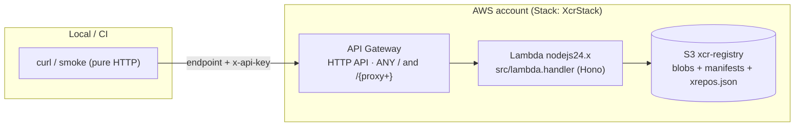

# OnMind-XCR — AWS architecture (CDK)

Infrastructure as code for running XCR on AWS (same pattern as XPS):

- **API Gateway (HTTP API v2)** — public front door (`ANY /` + `/{proxy+}`).
  Auth (`x-api-key` / Basic) is enforced **by the app**, not the gateway.
- **AWS Lambda** (`nodejs24.x`) — runs the same Hono app as the Bun container.
  Handler: `src/lambda.handler`, packaged as a **repo-root asset** (no bundler).
- **S3** — single bucket `xcr-registry` (key layout = filesystem layout:
  `docker-registry/blobs|manifests|uploads`, `docker-registry/xrepos.json`).

> CDK app is plain **JavaScript** (CJS, no TypeScript): `bin/app.js` +
> `lib/xcr-stack.js`. Node ≥ 20 required.

## Diagram



Parity: `bun src/dev.js` (filesystem) and Lambda (S3) share `src/` — only the
entrypoint and the storage binding differ.

## Limits (honest, v1)

- Proxied payloads flow through API Gateway + Lambda: single-digit-MB blobs
  and the 30s integration timeout apply to manifests, small layers and the
  chunked-upload flow.
- Large layers bypass Lambda: `presigned-put` issues a signed S3 PUT whose
  `x-amz-checksum-sha256` header forces S3 itself to reject wrong bytes;
  `presigned-complete` registers via HeadObject only. Pulls in `s3` mode
  answer `307` to S3 (docker follows the redirect). Set
  `XCR_PRESIGNED_READS=false` to proxy everything through the app instead.
- `xrepos.json` is read-modify-write, single-writer. Fine for labs/CI; add
  conditional writes before shared prod use.

## Configuration reference

All config is **CDK context** (defaults in `cdk/cdk.json`, override with
`-c key=value`) plus env-passed secrets:

| Context              | Default        | Maps to / effect                                   |
| -------------------- | -------------- | -------------------------------------------------- |
| `apiKey`             | *(empty = open)* | `XCR_API_KEY` — prefer `export XCR_API_KEY=...` so the secret stays out of argv/history |
| `bucketPrefix`       | `""`           | bucket name `{prefix}xcr-registry` (multi-env accounts) |
| `xcrEnv`             | `production`   | `XCR_ENV`                                          |
| `removalPolicy`      | `retain`       | `retain` \| `destroy` — see “S3 in production” |
| `corsOrigins`        | `""`           | comma list → `XCR_CORS_ORIGINS`                     |
| `localEndpoint`      | `""`           | emulator URL → `AWS_ENDPOINT_URL` + `XCR_S3_ENDPOINT` (+ path-style) inside the Lambda (Floci/LocalStack/RustFS) |

Secrets via env (never `-c`, never committed):

| Env                  | Effect |
| -------------------- | ------ |
| `XCR_API_KEY`        | `XCR_API_KEY` in Lambda (preferred over `-c apiKey`) |

Lambda environment (set by the stack): `XCR_ENV`, `XCR_STORAGE=s3`,
`XCR_S3_BUCKET`, `XCR_S3_PREFIX=docker-registry/`, plus optional
`XCR_API_KEY` / `XCR_CORS_ORIGINS` / endpoint overrides.

## S3 in production

Defaults: **a `cdk destroy` never loses data**:

| Setting                | Default   | Why                                                                 |
| ---------------------- | --------- | ------------------------------------------------------------------- |
| `removalPolicy`        | `RETAIN`  | Bucket (and blobs) stays in the account after stack deletion |
| SSE-S3                 | enabled   | encryption at rest, zero config |
| `enforceSSL`           | true      | no plaintext transport |
| Block public access    | all       | registry is never a website |
| Log group              | RETAIN + 14 d | function logs survive destroy, expire after 14 days |

- **Throwaway envs** (Floci, CI): pass `-c removalPolicy=destroy`
  so everything is disposable (objects auto-deleted).

## Deploy (real AWS)

```bash
# one-time
export AWS_PROFILE=your-profile
cd cdk && npm install
npx cdk bootstrap                                # once per account/region

# every deploy (secrets via env, never argv)
export XCR_API_KEY=$(openssl rand -hex 32)      # never commit this
npx cdk diff
npx cdk deploy
# → ApiEndpoint output (+ ApiId for a future custom-domain mapping)
```

Then use the `ApiEndpoint` output as registry host (HTTP API is HTTPS, so
`docker login` works without insecure-registries — subject to the v1
payload limits above).

## Test with the Floci simulator

```bash
docker run -d --name floci -p 4566:4566 \
  -v /var/run/docker.sock:/var/run/docker.sock \
  floci/floci:latest

export AWS_ENDPOINT_URL=http://localhost:4566
export AWS_ACCESS_KEY_ID=test AWS_SECRET_ACCESS_KEY=test AWS_REGION=us-east-1
export AWS_PAGER=
export CDK_DEFAULT_ACCOUNT=000000000000 CDK_DEFAULT_REGION=us-east-1

cd cdk
npx cdk bootstrap
npx cdk deploy \
  -c removalPolicy=destroy \
  -c localEndpoint=http://host.docker.internal:4566

API=$(aws cloudformation describe-stacks --stack-name XcrStack \
      --query "Stacks[0].Outputs[?OutputKey=='ApiEndpoint'].OutputValue" --output text)
curl -fsS "$API/health"
```

## Security notes

- `XCR_API_KEY` is optional at synth; set it for prod (lands in the Lambda
  environment — move to **Secrets Manager** when hardening for long-lived prod).
- CORS is enforced by the app (same behaviour on both runtimes); the gateway
  adds no second policy to keep parity.
- Asset packaging never ships `xcr-data/` / `.env` / `.dev.vars`.

## Commands

```bash
cd cdk
npm run synth      # cdk synth
npm run diff       # cdk diff
npm run deploy     # cdk deploy
npm run destroy    # cdk destroy
npm run bootstrap  # cdk bootstrap (once per account/region)
```
